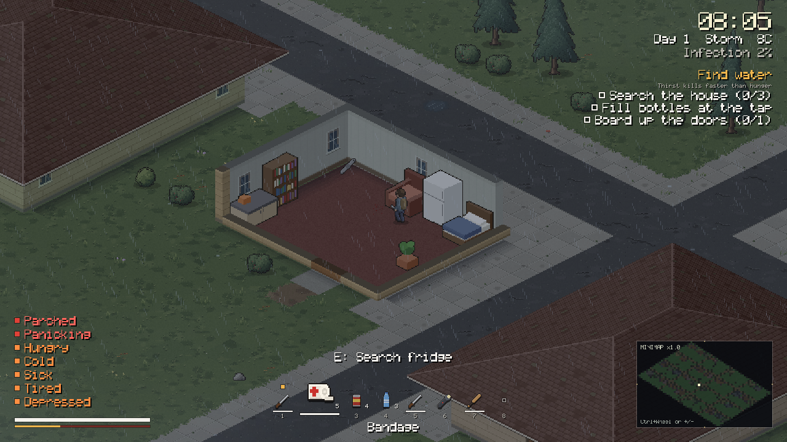
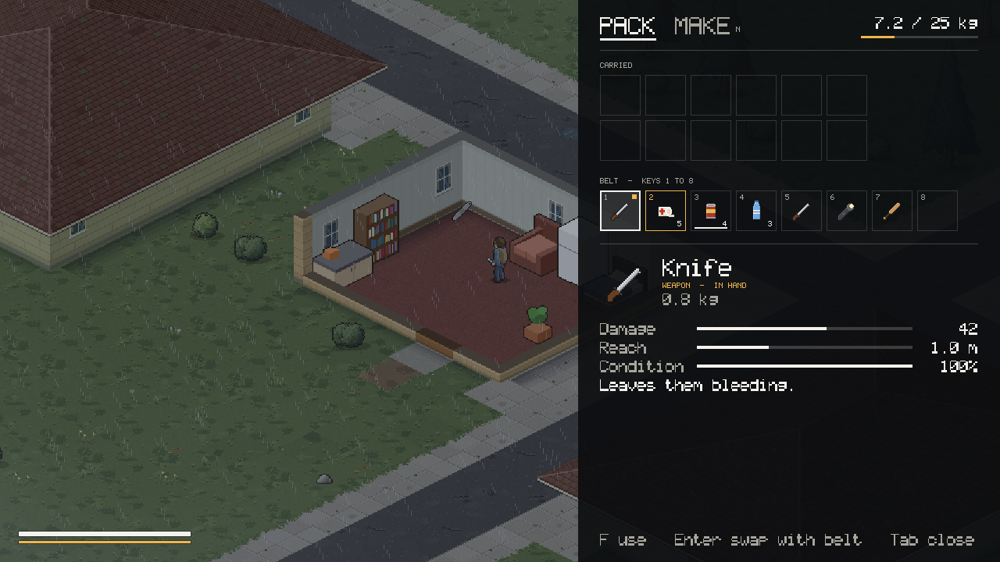
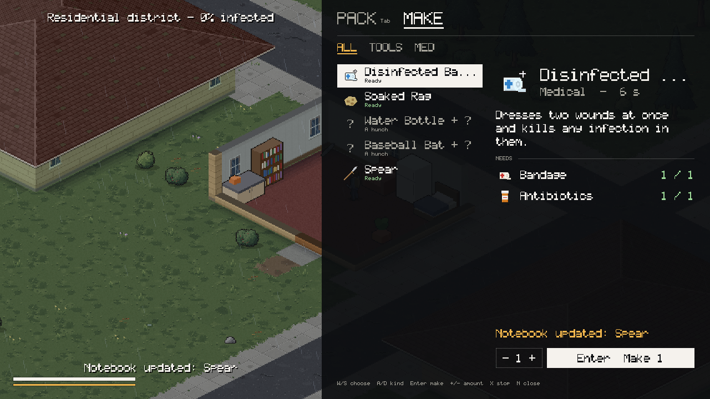

# Dead Pixel Survival — Revival Plan

Started: 2026-11-05 · Branch: `revival` · Owner: Claude (autonomous until handoff)

This is the living plan for reviving the project after a seven-month pause. It
replaces the old milestone backlog as the source of truth for what happens next.
The GDD (`dead_pixel_survival_gdd_v0.3.md`) is still the destination.

## Direction (decided)

- **Goal:** ship-quality. Build as if it will be released (itch.io demo first).
- **Hook:** the fixed world that remembers past runs. Graves, decayed bases and
  districts that have turned since last time, on top of Zomboid-style simulation.
  Every change is tested against this.
- **Scope:** keep every existing system and deepen them in waves, ordered by
  closeness to the hook:
  1. Core loop: scavenging, needs, noise and zombies, combat, readability.
  2. Legacy layer: graves, persistent bases, world memory, bloodlines.
  3. Extras: NPCs, vehicles, fire, crafting, modes, tone presets.
- **Camera:** isometric stays. Readability work covers wall/roof occlusion and
  diagonal-facing characters.
- **Tech:** no engine switch. Clean-up happens alongside features.

## Working rules

1. Nothing counts as done until it is seen working: a harness screenshot or
   metrics run, not just a successful build.
2. Every phase ends with a build, the tests, a harness smoke run and a commit.
3. `Game.cpp` only shrinks. New behaviour goes into systems or UI modules.
4. Saves stay compatible within the revival, or bump `saveVersion` on purpose.

## Phases

| # | Phase | Status |
|---|---|---|
| 0 | Branch, plan, CI fix | done |
| 1 | Dev harness: scripted autoplay, offscreen screenshots, metrics, input-latch fix | done |
| 2 | Baseline screenshots and assessment | done |
| 3 | Test target: core library, save round-trip and logic tests | done |
| 4 | Wave 1a: simulation pressure (mental, needs/temperature, zombie pressure) | done |
| 5 | Wave 1b: readability (scale/zoom, HUD rework, night lighting) | done |
| 6 | Walls with height, wall/roof occlusion, art generator upgrade | done |
| 7 | Split remaining `Game.cpp` (vehicles, fire, persistence duplication) | done |
| 8 | Wave 2: make the legacy hook visible | done |
| 9 | Wave 3: extras polish, tone presets with real effects | done |
| 10 | Docs, README and audit sync | done |
| 11 | Final verification and handoff | done |
| 12 | Wave 4: the first three days | in progress |

`Game.cpp` is split continuously: each wave moves the code it touches out
(e.g. the HUD rework extracts the HUD renderer).

## Baseline assessment (2026-11-05)

From the harness tour (`tools/harness/baseline_tour.txt`) and a two-day idle
soak (`tools/harness/soak_idle.txt`, world seed 1234):

**Look and readability**
- At default zoom the player is ~20 px tall; items are drawn as big as people.
  Humanoid sprites are authored at 64 px but rendered at 32 px.
- Buildings read as floor plans: walls are low studded tiles the player stands on.
- Ground is speckled with random dirt/stone/water diamonds that mean nothing.
- HUD: unlabeled bars, overlapping HP text, a column of small debug-style text,
  a large mode/threat banner, a hotbar of tiny text. Inventory is a bare text
  list over the world with no panel.
- Night darkens everything evenly. No light around the player or from windows.

**Simulation (idle soak, 2 game days)**
- 44 zombies, none came within 10 tiles in two days. No ambient pressure.
- Depression reaches the cap by 17:00 on day 1 from "isolation" (no zombie in
  sight gives +0.2/s). The 24 h crisis never starts because decay runs after the
  clamp, leaving depression at 99.998 < 100.
- Body temperature sits at 30 °C every night, indoors, with no consequence.
- Panic stays at 0 alone in the dark.
- HP stays at 100 until thirst hits exactly 0, then death within an hour.
  No gradual warning effects.
- A kill was credited with no player action: any zombie death counts as a kill.
- Idle survival ≈ 46 game hours, ended by thirst.

**Engine**
- Harness runs ~4,000 ticks/s hidden (2 game days in 43 s, Release).

## Wave 1a: survival model (2026-11-05)

Rates are per real second; 60 s = 1 game hour, 1440 s = 1 game day.

**Zombie pressure** (`ThreatDirectorSystem`, `ZombieAISystem`)
- Wandering is a correlated random walk with per-zombie RNG, idle pauses and
  wall bounces; long trips follow A* paths.
- Threat director, after a 150 s grace period: when fewer zombies than "desired"
  are within 14 tiles (day 1 + 0.5/day, night 3 + 1/day), it sends 2 (day) or 3
  (night) far wanderers toward a point 6–14 tiles from the player, every 70 s by
  day and 35 s by night.
- Population grows toward initial × (1 + 0.18/day) × (1 + infection rise) ×
  mode scale, spawning at least 24 tiles from the player, weighted toward
  infected districts. Threat modes scale migration and population.
- Attacks are telegraphed lunges: 0.55 s wind-up, hit only if the player is
  still in reach, 60% hit chance, 7 damage, 1.5 s cooldown. A lone zombie needs
  about 50 s to kill a player who does nothing. 35% of hits wound; 30% of
  wounds are bites and half of those are dirty.

**Needs and temperature** (`NeedsSystem`)
- Thirst empties in ~37 game hours, hunger in ~67, sleep debt reaches "tired"
  (70) after ~20 waking hours. Sleep halves the drain and pauses debt.
- Penalties ramp: stamina cap first (hungry/thirsty, parched/starving, cold,
  sick), then illness, then slow HP loss (dehydration ~8 h to death, starvation
  ~16 h, grave illness ~40 h).
- Body temperature drifts toward a target set by the air it feels: outdoor
  temperature, +10 under a roof, −4 for rain and −4 for wind outdoors, +18 near a
  fire or campfire, +5 with a jacket in the pack, plus heat from walking or
  running. Spring nights outdoors are chilly; rainy autumn nights are cold;
  winter nights outdoors are hypothermic and need a fire even indoors.
- Bites heal in 18 h, cuts in 6 h, bruises in 2 h. A dirty bite left untreated
  for 3 h becomes infected: +3 illness per game hour until antibiotics.

**Mind** (`MentalStateSystem`)
- Panic comes from zombies in line of sight within 7 tiles (hunters count fully,
  unaware wanderers 35%), low HP, and being outdoors at night (rises to a floor
  of 20, never higher). At 90+ with a hunter in view the character screams.
- Depression: +14/day alone, +3/night awake, +29/day per unmet need (hungry,
  thirsty, tired, cold, sick). Relief: −17/day sheltered with needs met, −72/day
  of company, −8 per full night's sleep.

**Idle soak results** (two days standing still, seeds 1234 / 42 / 777): found
and killed at 14:00 day 1 / 21:00 day 1 / survived one encounter, then died of
thirst at 07:30 on day 3. Idle play is never safe for long, but the timing
varies.

## Wave 1b: readability (2026-11-05)

**Scale and light**
- Characters draw at 64 px (pickups 24 px); default zoom 1.5, minimum 0.75.
- Night: ambient drops to 20% with dusk and dawn tints; light pools are
  ellipses on the iso ground; the player carries a faint personal light;
  campfires and fires flicker. Q toggles a flashlight cone (if carried) that
  doubles how far zombies can see you at night.

**HUD** (`src/ui/Hud.h/.cpp`, built from a `HudState` snapshot each frame)
- Top left: health and stamina bars with values. The part of the stamina bar
  that needs have taken away is drawn dark red.
- Below it, conditions in the style of status icons: only problems are listed,
  worst first, colored by severity (info, mild, serious, critical; critical
  pulses). Thresholds come from `NeedsSystem`, with early warnings (Peckish,
  Thirsty, Drowsy) shown before penalties start.
- Top right: day, clock (blue at night, amber at dusk), weather and outdoor
  temperature, and the infection of the district you stand in. Below it, one
  objective: the most urgent thing to do next (medical, water, food, sleep,
  search, or the campaign goal).
- Top center: a toast when you enter a new district.
- Bottom center: hotbar with item icons, counts and the selected item's name,
  with messages and the interaction prompt above it. Bottom left: car readout
  when driving or near a car.
- Red vignette below 40% health.
- Run mode, threat, tone, kills, loot and traits moved to the pause panel.
- Inventory (Tab) is a 4×5 slot grid matching the hotbar, with item details,
  freshness strips and a carry weight bar. Controls (F2) is a centered panel.
- Harness: `set STAT VALUE` forces player stats; `tools/harness/hud_states.txt`
  screenshots a fresh, a stressed and a night character.

## Walls, roofs and the town (2026-11-06)

**Structures** (`src/rendering/StructureView.h/.cpp`)
- Wall tiles draw as 56 px blocks (`kWallHeight`, must match `WALL_H` in the
  generator) that sort with entities by iso depth, so you can stand behind a
  wall. Each wall knows its run (along x, along y, corner), material (plaster
  houses, brick shops and the map edge, metal industrial) and whether it is on
  a building's outside edge. Outside walls get windows every few tiles;
  doorways get a frame on the face they open through.
- Each building has a flat roof (shingles, tar, ribbed metal) over its
  interior. It fades out while you are inside or standing at one of its
  doorways, and everything under a closed roof (zombies, loot) is not drawn.
- Cut-away: walls of your own building that are in front of you drop to 8 px
  stubs; outside, walls in a narrow band right in front of you do the same.

**Map** (`MapGenerator`, `src/map/TileIds.h`)
- Ground ids gained wood, tile floor, asphalt and sidewalk; each ground id has
  four textured variants picked per tile. Roads are asphalt with sidewalks.
- Rooms get one floor each by building type: houses wood/carpet/tile, shops
  tile or concrete, industrial concrete or metal plate.
- Buildings are closed: notch corners are walled, doors are only placed where
  there is floor behind them, and interior walls never block a doorway.
- Outdoor decor comes in clusters: dirt patches, small ponds, darker grass.

**Art** (`tools/generate_sprites.py`) draws the tileset (1024×128) and the wall,
window, doorway, stub and roof sprites; the old atlas content is unchanged.

**Harness:** `enter N` teleports into building N; `tools/harness/interiors.txt`
screenshots several interiors by day and night.

**Tests:** `tests/test_structures.cpp` covers wall classification, roof
open/fade/hiding, the cut-away rule, sprite collection and the generator
guarantees (closed buildings, doors that lead inside, one floor per room,
sidewalks along roads).

## Game.cpp split (2026-11-06)

`Game.cpp` (9,100 lines) is now ten files in `src/core/`, each a slice of the
`Game` class:

| File | What it holds |
|---|---|
| `GameShared.h` | constants, panel layouts and small helpers (namespace `gameshared`) |
| `Game.cpp` | startup, runs, saving, input plumbing, small queries |
| `GameScene.cpp` | building the world for a run (map, entities, loot, legacy traces) |
| `GameUpdate.cpp` | `update()` (now ~690 lines) plus sleep, animation, particles, noise |
| `GameMenus.cpp` | title screen and pause menu input |
| `GameInventory.cpp` | inventory, container, hotbar and crafting panel input |
| `GameFire.cpp` | lighting/putting out fires, burn and spread simulation |
| `GameVehicles.cpp` | getting in and out, refuelling, driving, fuel, wear, run-overs |
| `GameRunEnd.cpp` | death and retirement and what the next run inherits |
| `GameRender.cpp` / `GameUi.cpp` | world rendering / HUD snapshot and menu panels |

Death and retirement share one persistence path (`persistWorldForNextRun`).
Two fixes came with it: burn scars from earlier runs are no longer re-logged
as new world-memory events at every run end, and burn events carry the ending
run's index like graves and history do. Harness: `kill [cause]` and
`retire [cause]` end the run the way the game does.

## Wave 2: the legacy hook (2026-11-06)

The hook is a fixed town that remembers earlier runs. The save already held
that memory, but the game barely showed it: a grave sprite, a cairn, and a
notebook listing events by tile coordinates. Now every earlier life leaves
something the next one can find and act on:

| How the life ended | What later runs find |
|---|---|
| Zombies, or anything with an infected bite | They **rise**: a named, tougher zombie that stays near where they fell. Put them down and they get a grave, with their pack beside it. |
| Anything else | A **grave** with their epitaph, and their **pack** (everything they carried) until someone empties it |
| Retiring | A cairn, and they **live on** as a cautious survivor who keeps to themselves |

- **Run-start card:** "Run 4 - three came before you", then the nearest
  leads with distance and direction. Directions are on-screen directions
  (N is up), the same as the map's.
- **Name labels** over the risen, graves and retired survivors at close range.
- **Town map (M):**
  - isometric, oriented like the game;
  - buildings drawn as floor plans, plus roads, burn scars and infected
    districts;
  - named legacy markers and a legend.
- **Notebook (J):**
  - *What is out there*: live distance and direction to each lead.
  - *Who came before*: newest first, marked "walks again" or "at rest".
  - Totals across lives.
- **Minimap** dots use the same colours as the map and notebook
  (`legacyLeadColor`).
- **Start homes:** each run starts inside one of the homes near the town
  centre, chosen by the run seed.
- **Container panel:** restyled. The header no longer overflows, and the text
  uses an integer scale.
- **Code:**
  - The rules live in `src/legacy/LegacyRules` (who rises, lead order and
    text) and are unit tested.
  - The entities live in `GameLegacy.cpp`.
  - Grave records gained `items`, `risen` and `laidToRest`, with a save
    round-trip test.
- **Harness:** `slay R` and `goto risen|pack|grave`. The script
  `tools/harness/legacy.txt` plays four lives and captures each step.

## Wave 3: polish (2026-11-06)

- **Run-end screen:** death and retirement share one screen:
  - who they were and how it ended, with traits and run stats;
  - **what they leave behind**: "They will not stay down", "Their pack will
    wait by the grave" or "They will live on in town";
  - a grave or cairn icon, a fade-in, and a slim bar while the restart is
    held back.
- **Tone presets now change the run** (`src/systems/ToneTuning.h`, tested).
  GRIM HUMAN is the baseline.

  | Tone | Supplies | Weapons | Zombies at start | Zombie health | Nights | Colour | Stamina regen |
  |---|---|---|---|---|---|---|---|
  | HOPELESS | 70% | 80% | 100% | 115% | darker | drained | 90% |
  | BRUTAL ARCADE | 115% | 150% | 135% | 70% | brighter | punchier | 130% |

  Spawn cuts now pick a random subset, so they spread over the town instead
  of emptying the last-listed buildings. On the title screen the town behind
  the menu previews the tone's colour.
- **Title screen:**
  - big title, the menu on the left, and a line explaining the selected
    option (threat and tone descriptions included);
  - a "The town remembers" card: lives, graves, risen still walking, packs
    waiting, survivors;
  - the cursor skips "Continue Run" when there is nothing to continue;
  - "Options" is now named for what it opens: "Controls".
- **Doors** (`src/world/Doors.h`, tested):
  - Every doorway now holds a door, closed at the start of a run. A closed
    door blocks movement and sight like a wall.
  - Press **E** at a door to open or close it. It will not shut on someone
    standing in the doorway.
  - Zombies chasing or investigating something behind a closed door path to
    it and batter it. Each bang draws more of them, and after about 15
    zombie-seconds the door gives way: a loud crash, "A door gives way.",
    and the doorway stays open for the rest of the run.
  - Paths treat a closed door as expensive (cost 25), so the dead only batter
    the door that stands between them and you, not every door on the way.
  - Survivors open doors as they pass and leave them open.
  - **The town remembers broken doors**: a door the dead broke down is still
    broken in every later run. Mid-run checkpoints keep open and broken
    doors, this run's burn scars and burning fires.
  - New sprites: closed and broken doors in each wall material. In cut-away
    view, a closed door shows as a low wooden stub.
  - Harness: `zombie DX DY`, `doors`, `goto door`, `save` and `resume`; the
    scripts are `tools/harness/doors.txt` and `tools/harness/doors_memory.txt`.
- **Crafting screen rework:**
  - A centred panel in the notebook's style, with whole-number text scales,
    item icons and category tabs. Mouse hover and click share one layout with
    drawing, and hover follows the mouse only when it moves, so W/S keep working.
  - Undiscovered recipes read "Fuel Can + ?" and give a clue to the other half
    ("something that burns"). Each recipe has a clue for each ingredient
    (`hintA`/`hintB` in `recipes.json`).
  - Each recipe's needs (ingredients, tools, workbench) are listed with have /
    need counts. The panel shows progress, a craft button, "Missing: X" and
    recent messages.
  - Recipes written in a notebook appear in the J notebook under "What we
    know". Picking up a notebook writes down what this life already worked out.
  - Crafting takes 4 to 10 s instead of 40 to 90 s.
  - Crafted items now earn their cost:
    - Disinfected Bandage dresses two wounds and kills infection.
    - Spiked Bat hits 35% harder, lasts 50% longer and causes bleeding
      (per-item weapon scales in `items.json`).
    - New recipe: **Spear** (Knife + Wood Planks, Rope as a tool), with longer
      reach and lighter blows.
  - Harness script: `tools/harness/crafting.txt`.
- **Item icons:** every item has its own 32x32 icon in one style (solid
  shapes, light from the top-left, 1px dark outline). There are 16 redrawn
  icons and 13 new ones, from `add_item_icons` in `generate_sprites.py`.
  Nothing else in the atlas changes.
- **Furniture** (`src/world/Furniture.h`, `src/rendering/FurnitureView.h`, tested):
  - Every building is furnished from its layout, the same in every run.
    Rooms get a role from their floor and size: kitchen, bathroom, bedroom,
    living room or a one-room home; shop floor or back room; workshop.
  - 19 kinds of furniture, drawn as 64x80 isometric sprites that sort with
    walls and characters. Pieces with a front (fridge, bed, shelves...) stand
    with their back to a north or west wall; counters, shop shelves and racks
    run along the wall. Tall pieces fade when they would hide the player.
  - Furniture blocks movement but not sight, shots or fire, and it burns more
    readily. Doorways and the tiles around them stay clear, every room stays
    walkable end to end, and every piece can be reached (tests check this).
  - Most pieces are containers ("Search fridge") with loot that fits them:
    food in fridges, medicine in bathroom cabinets, tools in workshops. About
    half are bare (tone scales it). Searched furniture stays empty in later
    runs. Beds are sleep spots (8 h, better rest than a sleeping bag);
    sleeping bags now only appear in buildings without a bed.
  - The old stand-in props (flat crates, shelves and beds) and the district
    "loot container" pass are gone; indoor blood stains remain. Run spawns
    that land on furniture move to a free tile beside it.
  - Medical and supply caches are a well-stocked cupboard or crate: their
    loot goes into the nearest unsearched piece in the building that suits it
    (medicine in cabinets and shelves, supplies in kitchens and storage). Only
    a building with no such piece gets the old stand-alone prop.
  - An empty container says what it is: "Search fridge (empty)", "The fridge
    is empty.", and the panel header names it.
  - Harness: `goto furniture [KIND|any] [stocked]`; the script is
    `tools/harness/furniture.txt`.
- **Weapon in hand:** the weapon you fight with is an inventory item. Runs
  start with the knife in hand (it used to sit in the hotbar while you fought
  with default "improvised" stats). Wear is kept in the item, so taking a
  weapon out again does not mend it, and checkpoints remember which one was
  in hand. Weapon slots show a wear bar and a gold corner on the one in hand;
  the name reads "Knife - worn - in hand". Script:
  `tools/harness/weapon_wear.txt`.
- **Checkpoints keep the dead:** zombies walking at a checkpoint come back
  where they stood, wounds and all, and the ones you put down stay down (the
  risen still return with their graves). Older checkpoints without zombie
  data spawn a fresh town as before. Harness: `zombies`; script:
  `tools/harness/resume.txt`.
- **Characters that turn:** player, zombies and survivors are redrawn as
  outlined pixel figures in two views, front (walking down the screen) and
  back (walking up it), both mirrored for the left. The player faces where
  they aim, so the body, flashlight and swings agree; zombies and survivors
  face where they walk, and a zombie turns to its prey for a lunge. New poses:
  walk cycles, crouch and crouch-walk (bent knees), a swing, a zombie lunge
  with arms out, and lying dead. The player wears a backpack; zombies shamble,
  hunched, arms reaching. Script: `tools/harness/facing.txt`.
- **Bodies stay down:** a zombie put down leaves its body lying in a pool of
  blood (the risen still become graves). Bodies last the run, up to 60 with
  the oldest cleared first, and checkpoints keep them. Melee kills now count:
  the combat system used to delete its kills before the kill counter saw
  them, so they never reached the run's kills or desensitisation. Harness:
  `zombies` also prints bodies and kills; script: `tools/harness/corpses.txt`.
- **Boarding up:** at a closed door, R nails a plank across it (a hammer, or
  the back of an axe, and one plank per board; up to three). A boarded door
  will not open from either side; X pries a board off and gives the plank
  back. The dead split the boards one at a time ("A board splinters. 2 boards
  hold.") before they reach the door itself, and hammering is loud enough to
  draw them. Boards show on the door from outside and as a plank on the
  cut-away stub from inside. Checkpoints keep them, and so does the world:
  the next life finds a door boarded up as the last one left it. Harness:
  `doors` prints boarded doors, `goto door outside`; script:
  `tools/harness/boards.txt`.

## Wave 4: the first three days (2026-11-06)

The user steers again from here. Their brief: the first ~15 minutes are
not fun yet, so give a run a beginning, a middle and a turn.

### How a run starts today

- A run starts at 08:00 on day 1, and dark falls at 20:00. One game hour
  is one real minute, so day 1 lasts 12 minutes, and "the first 15
  minutes" means day 1 plus the start of night 1.
- The starting kit (knife, 3 cans, 2 bottles of water, 2 bandages) covers
  two days of water and three of food. Nothing on day 1 needs doing.
- The objective panel says "Search nearby buildings" until six items are
  looted, then shows the mode's objective. Nothing marks the days.
- Boarding up needs a hammer, and hammers only turn up on workbenches. A
  new character can almost never board a door on day 1.
- Nights only raise the number of zombies drawn toward the area: 3, 4 and
  5 for nights 1 to 3, aimed 6 to 14 tiles from you rather than at you.
  Nobody comes knocking.
- One zombie gets through a door with three boards in under a minute.
- Water only runs out: bottles are used up, and the rain collector (build
  mode, 2 scrap metal) is the only source that refills.

### The design

Give each day a job, give each night a test, and turn on day 3.

**Home.** The house a run starts in is home. It holds this character's
things, even when an earlier life emptied its cupboards:

- a hammer and 4 planks;
- food for two or three days;
- empty bottles;
- a bandage and painkillers.

The character carries only a knife, one bottle of water, one can and one
bandage. Searching the house is the first thing to do: it is safe and it
pays off.

**Taps.** Kitchen counters and bathroom sinks have running water at first.

- R at one drinks your fill and fills every empty bottle you carry.
- A drunk bottle leaves an empty one (new item: Empty Bottle).
- On day 2 the pressure drops, and the game says so.
- At 03:00 on day 3 the taps die.

The bottles you filled are your buffer. After that, water means a rain
collector or bottles found out in the world.

**A plan for each day and night.** The objective panel shows the plan
under its title: up to three steps with check boxes, and the time until
dark or dawn. Urgent needs (bleeding, thirst and so on) still take the
title. From the morning of day 4, the mode's objective returns. Day 2 asks
for more than the home holds, so it means going out.

| When | Plan | Steps |
|---|---|---|
| Day 1 | Secure the house | Search the house (n/m). Fill bottles at the tap. Board up the doors (n/m). |
| Each night | Hold out | Sleep in your bed. Keep doors boarded (n/m). |
| Day 2 | Stock up | Fill bottles (n/5). Find planks (n/4). Find food (n/6). |
| Day 3 | The taps are dry | Find water (n/3), or build a rain collector. Find food (n/6). Fully board doors (n/m). |

A broken door cannot take boards, so it drops out of the count.

**Nights get worse.** Each night sends callers: 2, then 4, then 6, then one
more each night after that. They come in up to three groups spread across
the night: the first at 21:30, the last at 02:30. Each group walks to you,
through your door if you are at home, and batters it on the way in.

- Night 1 sends them one at a time, the same in every mode. From night 2,
  the threat mode and tone scale the count.
- Boards are much tougher: 450 hp each.
- A zombie gives up on a goal it cannot reach after 90 seconds. Then it
  stays deaf to noise for 30 seconds, so its own banging cannot call it
  straight back (before this, one zombie at a door never stopped). Night
  callers are not turned by the din at the door either.
- Banging still draws other zombies nearby, and they join in.
- Banging within 12 tiles wakes you.
- At first light, the callers that have not got in drift away.
- At dawn a day card shows ("Day 2" and a line about the day).

Measured with `night_siege`: one caller, and the wanderers its banging
drew in, split about two of three boards before giving up. The second
caller got through unless the spare plank went up. Night 1 asks you to act
once. Night 2 needs the planks day 2 asks for. Night 3 means a fight.

**Day 3 turns.** The taps are dry, the house is picked clean and nothing
restocks. The plan sends you out for water, food and planks: the town and
the legacy layer take over from here.

**Not in this wave:**

- storing items in containers (containers are take-only);
- breaking furniture up for planks;
- day plans for days after 3.

## Art and feel, pass 1: characters and combat (2026-11-13)

Asked for by the user ahead of Wave 5: better art, animation and physics,
kept code-drawn and at the same pixel scale. Three passes; this is the
first. Branch `art-and-feel`.

**Characters.** `tools/charrig.py` is a small rig: a pose places the joints
of one 3D skeleton, and the rig draws it for five facings as shaded capsules
with a depth buffer (the game mirrors three of them, so eight facings in
all). One description of a walk therefore gives every facing and every
frame. The atlas grew to 4096x2048; the original 1024 px block is untouched
and the characters fill the block to its right (950 frames).

- Player: idle, walk (8 frames), run, crouch, crouch-walk and hurt, each in
  four loadouts (empty hands, club, blade, gun) so the weapon in hand shows;
  swing, stab, punch and shoot, driven frame by frame from the combat
  phases; a six-frame fall.
- Zombies: three looks (clothes, hair, skin), a dragging shamble that keeps
  time with their speed, a lunge whose coil is the telegraph, a stagger and
  a fall.

**Combat weight.**

- A blow throws a zombie back as real movement (it stops at walls), leaves
  it reeling and **breaks off a lunge it was winding up**. That last part
  changes the fight: timing a hit now saves you from one.
- A landed blow holds the world for a few frames, shakes the view and
  flashes the zombie; blood arcs along the swing, lands and stains the
  ground for a while.
- The dead go over backward along the blow, slide and settle. The strike of
  a lunge carries the zombie forward; a hit on the player shoves them.

**Movement.** The player gathers and sheds speed over a few frames. Zombies
no longer stand inside the player.

Checked with `tools/harness/combat_feel.txt` and `tests/test_feel.cpp`.

Still to do in later passes: (2) the world: tiles, walls, roofs, furniture,
props; (3) objects that move and atmosphere: thrown and dropped items,
debris, furniture with momentum, shadows, sway, rain splashes, drifting
smoke, footprints. Survivors still wear the player's frames with a tint.

## Art and feel, pass 2: the world (2026-11-13)

Still code-drawn, same pixel scale. Compare `docs/shots/pass2_before.png`
with `docs/shots/pass2_after.png`; `tools/harness/world_tour.txt` takes the
same twelve views again.

**Ground.** The outdoor textures in `tools/generate_sprites.py` are redrawn
around a muted moss palette: drifts, tufts and marks rather than per-pixel
noise. Dirt has pebbles, asphalt has worn patches and cracks, pavement slabs
differ in tone, water has bands and glints. The tileset gains three rows of
edge overlays after the four variant rows (`TileGid::fringeGid`, `shoreGid`,
`shadowGid`): grass creeping over whatever lies beside it, banks where water
meets land, and a shadow at the foot of every wall. `Game::renderMap` draws
them over the tile they belong to.

**Buildings.** Siding stands on a concrete footing with board joints, rain
streaks and trim; every brick has its own tone; sheet metal has rivets and
rust runs; windows have sills, curtains and graded glass; shingles vary, slip
and gather moss. Walls darken toward the ground and under the eaves.

**Scenery.** `tools/scenery.py` draws five trees, bushes, rocks, a stump,
grass tufts, flowers, a lamp post, hydrant and bin, and flat litter (paper,
cans, leaves, puddles, manholes, weeds, cracks). `scenery::plant`
(`src/world/Scenery.cpp`) places them from the tile map alone, by position
hash, so a town always grows the same scenery and nothing is saved. Trees
gather in groves. `SceneryView` sorts standing pieces with walls and
characters, lays flat ones under everything, and fades a tree that stands in
front of the player.

Trees, lamp posts, hydrants and bins fill their tile (`TileMap::setScenery`,
part of `isSolid`, not of `blocksSight`). One may only stand where all eight
tiles round it are open ground outdoors with no other blocker, so scenery
can never close a path. `Game::plantScenery` runs again once a run's people
and things are placed and leaves their tiles clear.

Not done here: furniture is unchanged, and the map generator still puts the
odd pond against a pavement.

## Buildings: thin walls and pitched roofs (2026-11-13)

Buildings no longer read as rows of blocks. The tile grid, collision, map
generator and saves are untouched: a wall still fills its tile for movement.
What changed is how `StructureView` draws it. See
`docs/shots/buildings_after.png` and `docs/shots/buildings_inside.png`.

**Walls.** A building's walls are pieces 8 px thick (`wallp_*`, drawn by
`make_wall_piece` in `tools/generate_sprites.py`). An outside wall stands on
the edge of its tile nearest the rooms (`WallPlace::EdgeN` and so on), a
corner is a post, and a wall between rooms runs down the middle of its tile
in half pieces that reach toward neighbouring walls. Textures repeat every
tile, so runs join without seams. Faces seen from the street carry the
building's material; faces seen from the rooms are painted plaster with a
skirting board. Each house gets a paint tint and a wallpaper tint from its
id. The ground under an outside wall is whatever lies outside it; under an
inside wall, the room's floor (`StructureTile::underGid`).

**Roofs.** A hip roof covers the whole footprint, walls included, so the
eaves overhang. Height over a tile is the least of up to four planes, one
rising from each side; `StructureTile::roofLevel` and `roofMask` pick one of
sixteen pieces per roof kind (`roofp_<kind>_<mask>`). Roofs rise four steps
and then flatten, so big sheds get a deck. A fascia board shows along the
eaves. A roof the player walks behind thins to 30 %.

**Shadows.** Wall shadows follow the thin walls (`wallAtEdge`,
`TileGid::shadowInsetGid`).

Walls that belong to no building (the brick wall round the map) are thin
too, down the middle of their tiles. Because a wall tile is still solid, there is a strip about 24 px wide
outside each house wall that cannot be walked on.

## Art and feel, pass 3: things that move, and weather you can see (2026-11-13)

`tools/harness/atmosphere.txt` shows all of it; see
`docs/shots/pass3_storm.png` and `docs/shots/pass3_lamp.png`.

**Weather.** `WeatherSystem` already decided the weather; nothing showed it.
`Atmosphere` (`src/systems/Atmosphere.cpp`) now does: rain streaks that slant
with the wind and thin out when you are under a roof, splashes on open
ground, a haze in heavy rain, fog with drifting banks, cloud shadows sliding
over the town by day, and lightning in storms (a flash, often a second
flicker, and a small shake). Cloud takes the edge off the daylight, cools it
and drains a little colour. Weather comes on and clears over a few seconds.

**Wind.** There is always a breath of wind and it gusts. Trees lean from the
trunk up, further in a gale (`SceneryView::lean`); bushes stir. Leaves come
off the oaks, three times as freely off the autumn ones, drift downwind and
lie where they land for a while.

**Things that move.** Bushes, tufts and flowers shake and shed a leaf or two
when anyone, living or dead, pushes through them. Cans and paper are kicked
along by passing feet, roll to a stop and bounce off walls; paper is carried
by a strong wind. A gunshot throws a spent case out to the side, which lies
where it falls, and lights the shooter for an instant.

**Lamp light.** Two street lamps in three still burn at night, and some of
those stutter and drop out (`SceneryView::lampState`). The six nearest are
lit, within the shader's sixteen lights.

None of this is saved, and none of it changes the rules: weather effects on
warmth, fire and noise are as they were.

Not done: doors still change state at a cut rather than swinging, there is
no weather sound, and snow is drawn as rain.

## Interface: bare hands (2026-11-13)

Four styles were mocked up (docs/mockups, and a design canvas); the one chosen
is the low-chrome "bare hands" HUD, with the pack and crafting as panels docked
to the right edge so the world stays in view.

- HUD (`src/ui/Hud.*`): no plates. Health and stamina are two thin lines in the
  bottom-left with conditions stacked above them, the time is large in the
  top-right over the day, weather and objective, and the belt is a row of bare
  item icons with the one in use drawn double size. Every label carries its own
  shadow instead of a backing.
- Pack (`renderInventoryPanel`, `InventoryLayout`): carried slots in two rows of
  six over the belt's eight, then the item under the cursor: weapon damage,
  reach and condition as bars, and how it compares with what is in hand.
- Make (`renderCraftingOverlay`, `craftingLayout`): the same panel, wider; the
  chosen recipe is an inverted row, each row says Ready / Missing something /
  A hunch.
- The HUD stays up while a panel is open, minus the belt, clock and minimap.

- Every other screen shares the palette (`kPanel*` in `GameShared.h`): title,
  pause, controls, container, notebook, run end and the legacy card lost their
  gold edges, and a chosen row is inverted everywhere. Build mode moved to the
  top-left and sits straight on the world like the HUD.

Not built: compass, noise meter, worn slots, a Body tab.

## Overhaul phase 1: foundations (2026-11-13)

The groundwork the other thirteen phases stand on. Items, loot and tuning
numbers are data (`assets/data/items.json`, `loot.json`, `tuning.json`); the
code names items through `ItemIds`, never by number. Containers are real
storage now: open one with E, move things between pack and container, and
what you leave stays there across saves and into the next life. Saves are
version 2 (older slots migrate, with backups). Ten defects fixed, among
them weather that rolled every minute, hit-stop that slowed the clock, one
bullet passing through a crowd, and a campaign deadline that killed you.

A bot (`bot PROFILE DAYS` in the harness) plays the game through the same
input a player uses, and `tools/soak.py` runs it over seeds 1 to 10. The
baseline, `bot_week.txt`, seed per row (runs repeat exactly per seed):

| Seed | Normal: days | Kills | Searched | Careful: days | Kills | Searched |
|---:|---:|---:|---:|---:|---:|---:|
| 1 | 0.3 | 23 | 13 | 0.4 | 30 | 30 |
| 2 | 1.5 | 39 | 39 | 0.5 | 11 | 26 |
| 3 | 0.7 | 29 | 41 | 0.5 | 12 | 25 |
| 4 | 2.2 | 40 | 47 | 1.8 | 33 | 5 |
| 5 | 1.1 | 22 | 5 | 2.1 | 22 | 6 |
| 6 | 1.3 | 17 | 4 | 1.0 | 22 | 4 |
| 7 | 1.5 | 27 | 14 | 1.3 | 25 | 6 |
| 8 | 0.7 | 25 | 43 | 0.8 | 23 | 21 |
| 9 | 1.3 | 30 | 29 | 1.0 | 20 | 9 |
| 10 | 1.0 | 25 | 10 | 0.9 | 24 | 25 |

Normal: median 1.2 days, mean 1.2; careful: median 0.9, mean 1.0. Every run
is clean (no crash, no stuck bot) and none lives the week. The first bot
died about seven game hours in on every seed (median 0.3 days); what was
wrong with it, and what the game does to a player who plays sensibly, is
below.

### Why the bot died, and what changed

Watched runs (metrics every game minute, screenshots every 30 seconds) and
the damage taken per bot activity showed, in order:

- **A game defect: panic drift ran away.** Above about 50 panic the drift
  (meant to be up to 80 px/s) was added to the velocity every tick, faster
  than the legs can steer it back, so a frightened player slid off at 750 to
  1600 px/s, out of control, into crowds and across the town. It was there
  before phase 1. Fixed: the drift is an offset taken off again before the
  next tick's steering; `hud_states.txt` checks a panicked walk stays under
  300 px/s.
- **The bot fought with a broken knife.** A broken knife reaches 19 px,
  inside a zombie's lunge. It now swaps to the best weapon carried (by damage
  and reach after wear), keeps two, and runs from anything when it has
  nothing that outreaches them.
- **It sprinted everywhere.** Running fills fatigue in 12 seconds and
  fatigue only falls standing still; at 100 it halves stamina. It now walks
  unless one is within three tiles, and stops to rest when tired.
- **It could not open most cupboards.** Interaction reaches 32 px, centre to
  centre, so standing in front of one is just out of reach. It now leans in,
  as a player does, and finds the home kit (hammer, planks).
- **It pinned itself** against walls while fleeing and **stood still while
  bitten** by a zombie it had given up on. It now turns and fights when
  pinned, and never ignores one in reach.
- **It let hunger and thirst fall below 55**, where health stops coming back.
  It eats and drinks at 60 now, heads home below 70 % health, comes home at
  16:30, keeps still at home after dark and when stocked, and never pries its
  own boards off from the inside.

### What still kills it: the game, not only the bot

With all of that the median rises from 0.3 to 1.2 days and stops there;
further changes moved it between 1.1 and 1.5. The evidence that day one is
this lethal for a sensible player:

- A player who stands in the home all day is dead by about 22:00 on day 1
  (seeds 1, 3 and 5), and was the same before phase 1, so it is not a
  regression.
- Started at home at 15:00 with a bat, a hammer, six planks, food and water,
  the bot is dead within 1.4 days on 6 of 10 seeds, having killed 19 to 50 of
  the dead.
- Hordes of 15 to 45 of the dead within 10 tiles appear on most seeds,
  usually just before the death.
- Health comes back at about 1 point an hour awake (and only with hunger and
  thirst above 55), against 7 a bite.
- With six boards on the home's two doors and eight of the dead outside at
  dusk, three boards were gone within the hour.

So phase 1's bar (the normal bot lives a median of three days) is not met,
and was not reached by bending the game: no balance number was changed.
Phases 3, 4 and 14 read this section (see `docs/overhaul/DECISIONS.md`).

## Overhaul phase 2: the home base (2026-11-14)

A home worth defending. Furniture is material: hold E beside a movable piece
and walk to push it (heavy pieces slowly, through open doorways), push one
onto the floor inside a door and the dead must break it after the door; X
breaks a piece up for planks and rags. Windows are real: the dead see you
through glass (6 tiles) and through a lit, uncurtained window at night,
break it (Loud, glass outside) and climb in one at a time; you can climb an
empty frame, draw a curtain, or board it (R: a plank and 2 nails, up to 2
boards of 300). Door boards now cost 2 nails too (the home kit has 12). The
old build mode is gone: B opens a wheel of stations (campfire, workbench,
storage crate, rain collector, bedroll) built where the ghost shows, and F
sets down can alarms, spike boards, candles and can lanterns. Sleep is as
good as the room is safe, and the prompt says what is open. The night's
callers pick the weakest way in; the day plan asks to "Close up the house".
What the player did to a house (furniture, windows, stations, a crate's
contents) carries into the next life, which may start in that house or
hear of it.

Harness: `base.txt` (a bookshelf in the doorway held the dead after the
door; a zombie that could not see the player gave up on it), `windows.txt`
(every window state in siding and brick, inside and out; a candle draws the
dead, a curtain does not; glass breaks, they climb in; two boards held for
42 s and more; all kept by a checkpoint and the next life). Every older
script still passes.

The bot boards the weakest way in first, windows included, and draws the
curtains when it has no planks. `bot_week`, seeds 1 to 10, next to phase 1:

| Seed | P01: days | P02: days | Kills | Searched | Boards | Died at home, night 1 |
|---:|---:|---:|---:|---:|---:|---|
| 1 | 0.3 | 1.2 | 27 | 41 | 2 | - |
| 2 | 1.5 | 0.5 | 19 | 32 | 3 | yes (19:08) |
| 3 | 0.7 | 1.0 | 21 | 71 | 3 | - |
| 4 | 2.2 | 1.1 | 25 | 31 | 6 | - |
| 5 | 1.1 | 1.2 | 30 | 5 | 3 | - |
| 6 | 1.3 | 1.7 | 32 | 45 | 0 | - |
| 7 | 1.5 | 1.1 | 27 | 6 | 0 | - |
| 8 | 0.7 | 0.5 | 28 | 29 | 0 | - |
| 9 | 1.3 | 0.5 | 11 | 7 | 4 | yes (20:29) |
| 10 | 1.0 | 0.4 | 20 | 10 | 0 | - |

Normal bot, median 1.0 days (phase 1: 1.2), mean 0.9, none lives the week,
every run clean. The phase's bar, at most 1 of 10 dead at home on night 1,
is **not met: 2 of 10**. Both died in the evening of day 1, before the
first caller sets out (21:30), with no caller about and 6 to 12 of the
ordinary dead round the house; seed 2 came home at 46 health and was caught
boarding a window. That is the day-one pressure phase 1 recorded (a player
standing at home is dead by about 22:00), now with glass the dead see
through; day one's lethality is phases 3, 4 and 14's to settle, and phase 2
did not retune it. Four seeds put up no boards at all (why is not yet
looked into).

## Overhaul phase 3: fighting (2026-11-14)

Fighting with the body, not just the click. Every weapon has its own speed,
reach, wear and special from the data (a spear reaches, a blade can stick,
heavy tools knock down). Space shoves: one thrown back loses its lunge, and
one hurt or shoved from behind goes down; one on the floor can be stomped
(any swing aimed at it, double damage) or taken down (right click, then
left). The dead grab: a lunge that reaches you is a claw or a hold (always a
hold from behind unless your back is to a wall, or when you are out of
breath); held, the view closes in and shakes, each holder bites, and quick
taps of Space (four per holder) tear you free. G throws, with an arc while
held: rocks, cans and bottles draw the dead to where they land, a wound
alarm clock rings for 20 s and holds them there, a flare burns red at night,
a molotov lights the ground (the L key is gone). Guns cost you: the pistol
and shotgun load from the pack with R, are heard far off, jam when worn and
click empty. New weapons: frying pan, machete, sledgehammer, spiked bat,
glass shiv, chair leg; two pistols, a shotgun, machetes and sledgehammers
wait in the town's outer wardrobes. Hits feel different by kind (a shove,
a blade, a shot, a heavy blow).

Harness: `fighting.txt` (a shove breaks a lunge; the hurt and one shoved
from behind fall; a bat's stomp kills a downed 50-health one; the
take-down; one walking up grabs within three lunges and four taps free; a
sledgehammer fells a full-health one), `throwing.txt` (a rock at 8 tiles
turns two to the spot; a clock holds three for 20 s; a flare at night; a
molotov lights its tile; a bottle breaks), `guns.txt` (reload; a pistol
shot kills at 6 tiles, costs one round and brings every wanderer in
earshot; the empty click; the shotgun drops two side by side). Every older
script still passes; `weapon_wear` now wears on hits only.

The bot shoves when two of the dead are within 1.5 tiles, struggles when
held, and never uses guns. `bot_week`, seeds 1 to 10, next to phases 1
and 2:

| Seed | P01: days | P02: days | P03: days | Kills | Searched | Boards | Died at home, night 1 |
|---:|---:|---:|---:|---:|---:|---:|---|
| 1 | 0.3 | 1.2 | 0.1 | 5 | 10 | 0 | - |
| 2 | 1.5 | 0.5 | 0.9 | 27 | 52 | 5 | - |
| 3 | 0.7 | 1.0 | 1.7 | 29 | 75 | 5 | - |
| 4 | 2.2 | 1.1 | 2.1 | 49 | 42 | 3 | - |
| 5 | 1.1 | 1.2 | 1.7 | 17 | 5 | 3 | - |
| 6 | 1.3 | 1.7 | 0.4 | 15 | 60 | 2 | - |
| 7 | 1.5 | 1.1 | 0.6 | 14 | 8 | 3 | - |
| 8 | 0.7 | 0.5 | 1.3 | 16 | 17 | 3 | - |
| 9 | 1.3 | 0.5 | 0.8 | 21 | 8 | 5 | - |
| 10 | 1.0 | 0.4 | 0.1 | 6 | 26 | 0 | - |

Normal bot, median 0.9 days (phase 2: 1.0), mean 1.0, none lives the week,
none dies at home on night 1 (phase 2: 2), every run clean. The phase's
bar, a median no more than one day below phase 2's, is met. The spread is
wider: three runs reach day 3, and two (seeds 1 and 10) die within hours
of the start, with 5 and 6 kills (why is not yet looked into; the hold is
the new danger to check first). Day one's lethality stays phases 4 and
14's to settle.

## Overhaul phase 4: the dead (2026-11-14)

Five kinds of dead, told apart by shape: the Shambler; the Runner (lean,
redder, its head snaps up for half a second, then 1.7x for 8 s and winded
4 s; a sprint that reaches you always grabs); the Brute (broad and grey,
150-190 health, not moved by a light blow, its shove puts you on the floor
for 0.8 s, x3 on doors and boards, the ground shakes near it); the Crawler
(prone, slow, hidden in grass or by furniture past 2 tiles, bites the legs:
hobbled 20 s; 30 % lie in wait by furniture and wake with a scrape at 2
tiles); the Screamer (pale, arms down; on sight it screams 1.2 s, Loud,
keeps 4 to 6 tiles off and screams every 10 s). Shares come from
`assets/data/zombies.json` and grow by day; districts over 50 % infection
double the Runner and Screamer shares. Night callers include a Runner in
four from night 4 and a Brute from night 6.

Senses: sight in a 160-degree cone for the unaware, x0.6 in the dark, x1.3
when you are lit, less when you crouch, and an awareness meter that fills
and drains (a head lifts above 0.4); hearing by tier radius, one tier
lower through a sealed building's shell, scaled by rain and wind, with
thunder in storms; blood trails from bleeding or open wounds, drawn on the
ground, fading by place and rain, followed by the dead. Decomposition
matters (a Bloated one bursts, a Decayed crowd sickens, the Skeletal can be
waded through). Crowds clump; hordes cross the town on set nights (night 7,
then every 4 to 6; Swarm and Hybrid from night 5 every 3 to 4) along the
roads past the home, pass a dark shut house by and turn to a lit window.
Each threat mode reads its rules from the data: Swarm many and weak,
Stalker few and relentless with one follower, Mutating worse each day,
Society fewer and slower, The Unknown two hidden rules a run that the
notebook writes down once seen three times, Hybrid Swarm then Mutating.
Districts carry their infection between lives (-10 a life), lose 0.15 a
kill, and show a ruin level (quiet, uneasy, turning, overrun) on the HUD,
on the town map, and in litter, smears and bodies on the street. Bodies can
be searched (E). Deaths now say what did it: "Overrun by the dead" (five
or more within 3 tiles), "Hunted down by the zombie that followed", or the
kind that struck last. The AI is split into senses, movement and attack,
with a spatial grid and a shared flow field: 300 of the dead average 1.3
ms a tick, worst 4.4 ms (bar: 4 and 12).

Art: `tools/charrig.py` draws the four new kinds with their own builds,
tints and moves (a sprint and a start pose, a heavy walk, a prone drag, a
scream) in all three clothing looks, plus an alert frame for every kind;
the atlas grew to 4096 x 4096 with the kinds in the lower half.

Harness: `kinds.txt` (five silhouettes apart at default zoom; a Runner
covers 10 tiles in under 4 s; a knife does not move a Brute; a scream
brings a wanderer from 20 tiles; a dormant Crawler wakes at 2 tiles),
`senses.txt` (crouched and still in the dark, unseen for 10 s at 5 tiles;
running, heard; a swing in a shut house not heard 10 tiles out, with the
door open it is; a walk in heavy rain not heard at 5 tiles; a bleeding
walk followed within 60 s, a dressed one in rain not), `horde.txt` (a dark,
curtained house passed by; a candle in a clear window, broken into),
`perf.txt`, and `ruin.txt` (the ruin levels on the street, the HUD and the
map; blood drops). Every older script still passes; `guns.txt` now checks
a shot is heard within 16 tiles (P04's wind and the Brute's hearing).

The bot is unchanged (the phase asks nothing of it). `bot_week`, seeds 1 to
10, in each threat mode (`tools/soak.py --mode`), days survived:

| Seed | Swarm | Stalker | Mutating | Society | Unknown | Hybrid |
|---:|---:|---:|---:|---:|---:|---:|
| 1 | 1.6 | 2.2 | 0.9 | 2.1 | 0.6 | 1.5 |
| 2 | 1.7 | 2.5 | 0.9 | 3.0 | 0.4 | 1.6 |
| 3 | 1.2 | 0.8 | 0.9 | 2.1 | 1.1 | 1.0 |
| 4 | 0.8 | 3.9 | 1.7 | 4.0 | 2.5 | 2.0 |
| 5 | 1.7 | 2.8 | 0.6 | 1.6 | 0.7 | 1.9 |
| 6 | 1.4 | 2.6 | 0.8 | 2.1 | 2.0 | 1.7 |
| 7 | 2.0 | 2.8 | 1.9 | 3.2 | 1.9 | 1.3 |
| 8 | 1.9 | 1.6 | 0.7 | 2.0 | 1.1 | 0.7 |
| 9 | 1.3 | 3.0 | 2.6 | 2.9 | 3.0 | 2.3 |
| 10 | 1.2 | 2.4 | 1.5 | 2.9 | 1.9 | 0.4 |
| **Median** | **1.5** | **2.5** | **0.9** | **2.5** | **1.5** | **1.6** |

| Mode | Mean days | Median kills | Died at home, night 1 | How it ended |
|---|---:|---:|---:|---|
| Swarm | 1.5 | 32 | 1 | overrun 8, killed 1, a Brute 1 |
| Stalker | 2.5 | 32 | 0 | overrun 7, killed 2, a Brute 1 |
| Mutating | 1.2 | 25.5 | 2 | overrun 6, killed 4 |
| Society | 2.6 | 38 | 0 | overrun 9, a Brute 1 |
| Unknown | 1.5 | 27.5 | 1 | overrun 7, a Brute 2, infection 1 |
| Hybrid | 1.4 | 31.5 | 1 | overrun 9, killed 1 |

("Killed" is the last blow from a Shambler or Screamer with fewer than five
round you.) All 60 runs clean; none lives the week. The modes play
differently in length: Stalker and Society twice as long as Mutating,
Swarm and Hybrid between. Swarm (the default mode, so phase 3's 0.9 is
its baseline) went from 0.9 to 1.5. **Stalker and Swarm differ in day of
death (median 2.5 against 1.5) but not in cause**: in both the bot dies
overrun at home, and in no Stalker run did the follower land the last
blow. The bot does not read the modes: it boards up and waits whatever
comes, so a mode's character shows only in how long that lasts. Not
retuned here (see `docs/overhaul/DECISIONS.md`).

## Overhaul phase 5: body and mind (2026-11-14)

Who wakes up: a character screen before each run (a name, traits good and
bad whose points must balance; Space takes the seed's pick). Seven skills
(Carpentry, Fighting, Fitness, Scavenging, Medicine, Mechanics, Living off
the land) rise with use and fade slowly unused; Carpentry makes boarding
quicker and boards tougher (a second plank from level 3).

The body: wounds land on a part (head, torso, arms, legs) as cuts, bites,
bruises or breaks, shallow or deep, and each needs its own care. A dressing
goes dirty after 12 hours, a deep cut opens again on swings until
stitched, a broken leg slows you 45 % (20 % splinted), a broken arm rules
out two-handed weapons. Antibiotics cure infection; the Disinfected
Bandage only cleans. A BODY tab (Tab cycles Pack, Body, Make) shows and
treats them. Sleep debt builds and is paid back in bed.

The mind: panic and depression come in named bands that change how you
move, work and sleep (panic 60 makes boarding 30 % slower); a slow breath
(crouch held still 3 s) calms; a book lowers depression once. A tired or
frightened mind sees false figures that touch nothing in the simulation.
Boarding is now a held action (about 4 s at Carpentry 0); panic drift only
nudges a walk, so it no longer carries a player out of reach mid-board.

Old checkpoints load without a version bump (single traits become lists,
a wound without a part is on the torso). Harness: `character.txt`,
`body.txt`, `mind.txt`; all 35 scripts pass, 194 unit tests pass, clean
build without warnings.

The bot treats wounds with what it carries (splint, stitches, dressing,
antibiotics) and stands still to board (its steering had cancelled the
held action: 0 boards on every seed until fixed). `bot_week`, seeds 1 to
10, default mode:

| Seed | Days | End | Kills | Boards |
|---:|---:|---|---:|---:|
| 1 | 2.0 | Overrun, day 3 | 79 | 5 |
| 2 | 2.0 | Infection, day 3 | 46 | 1 |
| 3 | 2.6 | Overrun, day 3 | 25 | 0 |
| 4 | 1.8 | Bled out, day 3 | 55 | 3 |
| 5 | 1.8 | Overrun, day 3 | 51 | 1 |
| 6 | 0.8 | Killed, day 2 | 35 | 2 |
| 7 | 2.5 | Overrun, day 3 | 41 | 3 |
| 8 | 0.6 | Infection, day 1 | 11 | 0 |
| 9 | 1.2 | Overrun, day 2 | 34 | 0 |
| 10 | 0.9 | Overrun, day 2 | 17 | 0 |

Median 1.8 days (Swarm in phase 4: 1.5), mean 1.6; 10 of 10 clean; none
died at home on night 1. Deaths: overrun 6, infection 2, bled out 1,
killed 1. Infection appears but does not lead, as the phase asks.

## Overhaul phase 6: scavenging and the town that runs out (2026-11-14)

Buildings with a purpose: every building has a kind (grocery, pharmacy,
hardware, clinic, police, diner, office, garage, warehouse, workshop or
house), a pure function of the layout, so old towns get the same kinds.
Shops are furnished by kind (shelves and a checkout, a pharmacy counter
and a locked stock room, an armoury locker, cots, desks, filing cabinets,
pallet stacks) with eight new pieces, and a pictogram sign over the street
door; the town map marks the kinds you have seen, and remembers them.

Getting in: doors can be locked ("Locked."); a crowbar forces one in 6 s,
a weapon or a shoulder breaks it, a window breaks or is taped quietly,
half of locked buildings have an open back door, and one kitchen cupboard
in eight holds a key ring for the street. Alarmed shops ring for 45 s
while the power is on, until the box by the door is stopped. Searching a
container is a held action (1.5 to 5 s), and a searched one stands ajar.

The town runs down: Dirty Water from ponds, toilets and stale collectors
(boil it or use tablets); power until about 19:00 on day 5, flickering
from day 4, then street lamps, floor lamps, fridges and alarms die; food
goes fresh, stale, spoiled; cooking at a campfire or a powered stove (a
FOOD tab); foraging bushes, trees and tufts; snares; garden beds that
grow, die dry and come back as seedlings in the next life; a backpack,
dropping on the floor (Backspace), batteries, and a radio that gives the
forecast. The notebook counts cupboards still unopened and the map tints
districts by what is left.

Save version 3: a version 2 slot is backed up (`*.v2.backup`), shops are
refurnished, container records on tiles that no longer hold a container
are dropped, houses are untouched (floor lamps are placed last with their
own dice). Checked by `save_v2_slot_migrates_to_v3` and by hand in the
game: a version 2 slot with four container records loaded, kept the
house's and the shop's real containers, dropped the two stale ones, and
ran.

Harness: `town_kinds` (seeds 1234, 42, 777), `break_in`, `power_out`,
`cooking`, `garden`; all 40 scripts pass (42 runs, each in a fresh
directory, on the final build), 209 unit tests pass, clean build without
warnings. The screenshots of the five new scripts were looked at; they
showed the HUD's message line running off the narrowed world and over the
condition labels while a panel is docked, which is now fixed. 300 of the
dead: 1.5 ms a tick on average. `power_out` forces the failure with `power
soon` rather than waiting at `day 5`, `hours 18.9`; the hour itself is
covered by the unit test `power_fails_on_day_five_near_dusk`.

The bot drinks Dirty Water only when nothing clean is carried, fills
bottles at toilets and ponds, forces locks with a crowbar and ranges
further each day. It had stepped while pressing E at a cupboard, which
cancelled the new held search (1 to 14 containers a run, no boards on any
seed) until fixed. `bot_week`, seeds 1 to 10, default mode (run on the
build before the HUD fix, which touches no simulation; `bot_week` seed 1
was run again on the final build with the same result):

| Seed | Days | End | Kills | Food | Drink | Searched | Boards |
|---:|---:|---|---:|---:|---:|---:|---:|
| 1 | 2.9 | Overrun, day 4 | 64 | 9 | 10 | 96 | 3 |
| 2 | 2.6 | Killed, day 3 | 72 | 6 | 3 | 48 | 1 |
| 3 | 1.6 | Overrun, day 2 | 45 | 11 | 5 | 53 | 1 |
| 4 | 0.9 | Overrun, day 2 | 32 | 7 | 7 | 7 | 1 |
| 5 | 3.9 | Overrun, day 5 | 71 | 12 | 6 | 66 | 2 |
| 6 | 3.2 | Overrun, day 4 | 48 | 5 | 1 | 19 | 3 |
| 7 | 0.7 | Overrun, day 1 | 15 | 8 | 7 | 32 | 3 |
| 8 | 1.6 | Overrun, day 2 | 42 | 10 | 10 | 54 | 0 |
| 9 | 0.5 | Overrun, day 1 | 3 | 7 | 7 | 7 | 0 |
| 10 | 1.4 | Overrun, day 2 | 21 | 6 | 2 | 43 | 2 |

Median 1.6 days (phase 5: 1.8), mean 1.9 (phase 5: 1.6); four lives
reach day 4 or 5 (phase 5: none past day 3); 10 of 10 clean; seed 9 died
at home on night 1 (phase 5: none). Deaths: overrun 9, killed 1; none
from thirst in either phase, so "deaths from thirst after day 3 fall"
cannot be read. "Days survived rises" is met on the mean and the longest
lives, not on the median. Seed 9's night and boards that come down and
are not put back are leads for phase 14 (`DECISIONS.md`).

## Overhaul phase 7: weather, seasons and fire (2026-11-14)

One table of consequences (`src/world/WeatherRules`, pure, one function
per column) that every system asks: the player's view fades on the world
shader by condition (fog from 5 tiles, a blizzard from 3), the dead see
and hear less in rain, fog and snow and more in a lightning flash, the
body is shifted outdoors (rain -4 C, a storm -6, a heatwave +8, a
blizzard -8 with cold coming twice as fast), fires spread by the weather
and die in the rain. New conditions: Heatwave, Snow and Blizzard; Wet
(20 minutes of rain without a Raincoat), Overheated and Coughing. A
Winter Coat (warmth 11) and a Raincoat; the warmest thing carried is
marked "worn" in the pack. Footprints in mud and snow from the player,
survivors and the dead. The sky warns 90 minutes ahead (cloud and wind
before rain, darker before a storm, haze before fog) and the HUD adds a
second word ("Clear, clouding").

Seasons: dusk and dawn move with the season (winter 08:00-17:00, summer
05:00-21:30, blended over three days), and the dead's night, the lamps and
the night callers follow. Summer spoils food quicker and its dead are
busier by night; autumn ends the bushes' fruit on day 40, brings
mushrooms and "Frost on the windows." on day 43; winter snows instead of
raining, lays snow on the ground over six hours (and a pale wash on the
roofs), freezes ponds (walkable, slippery, an axe or hammer to reach the
water) and collectors, stops gardens and slows the dead in snow. The
season is a word on the clock line and its first day's dawn card names
it.

Fire is a tile grid (`src/systems/FireSystem`): fuel by what is on a tile
(grass, floors, furniture, boards, trees, the wooden walls of a house),
heat that builds, spread every 2 s with the wind, rain that takes heat
away, damage through the spatial grid with kills credited to whoever lit
it, light clustered to 8 sources, a Loud fire every 2 s, smoke that fills
a burning house, and the dead walking into it (one in five keeps walking
alight for 6 s). A house with 40 % of its floor burned is gutted: charred
rafters (`roofp_burnt_<mask>`), sooted walls, doors and windows gone, its
furniture and what it held destroyed; it stays gutted in world memory, is
never a start home and is darkened on the town map. Burned ground is
drawn charred, trees burn to black trunks, grass grows back on the third
life. Firewise takes 40 % less fire damage and sees what would burn when
holding a Molotov or Matches.

Harness: `weather_rules` (every condition's noise, sight and body
numbers match the table; fog hides a zombie at 8 tiles and shows one at
5), `seasons` (snow 0.33, 0.67 and 1.0 after two, four and six hours; the
pond walkable; the collector empty; 34.3 C, Cold, after two hours of a
night outdoors with nothing warm; 37.0 C with a Winter Coat by a fire
indoors), `fire_spread` (a molotov in a heatwave with the wind east: 4
tiles east, 3 west after five game minutes; out in heavy rain within 40
game minutes, 7 east and 3 west by then; a house lit inside gutted, and
still gutted in the next life). 300 of the dead: 1.4 ms a tick on
average, 3.1 ms worst; with 60 to 66 tiles burning as well: 1.5 ms and
2.4 ms (phase 4 budget: 4 and 12). All 43 scripts pass (45 runs, each in
a fresh directory, on the final build), 224 unit tests pass, clean
rebuild without warnings. The new scripts' screenshots were looked at;
they led to the burned floor being drawn dark, snow tiles without
stripes, roofs under snow going grey-white rather than pink, flames off
the tile grid, and the fog shots taken away from a house's sheltered
strip.

The bot was not changed (the phase asks nothing of it). `bot_week`, seeds
1 to 10, default mode, on the final build:

| Seed | Days | End | Kills | Food | Drink | Searched | Boards |
|---:|---:|---|---:|---:|---:|---:|---:|
| 1 | 3.5 | Overrun, day 4 | 80 | 8 | 6 | 106 | 3 |
| 2 | 3.6 | Overrun, day 4 | 55 | 6 | 2 | 105 | 0 |
| 3 | 2.0 | Overrun, day 3 | 50 | 8 | 5 | 49 | 1 |
| 4 | 1.5 | Beaten by a Brute, day 2 | 41 | 6 | 7 | 12 | 1 |
| 5 | 2.8 | Overrun, day 4 | 62 | 13 | 4 | 53 | 1 |
| 6 | 1.9 | Killed, day 3 | 46 | 6 | 3 | 19 | 3 |
| 7 | 1.3 | Overrun, day 2 | 34 | 15 | 12 | 108 | 3 |
| 8 | 0.9 | Overrun, day 2 | 29 | 8 | 8 | 19 | 0 |
| 9 | 0.9 | Overrun, day 2 | 21 | 7 | 7 | 11 | 0 |
| 10 | 1.1 | Infection, day 2 | 19 | 6 | 3 | 43 | 1 |

Median 1.7 days (phase 6: 1.6), mean 2.0 (phase 6: 1.9); 10 of 10
clean; 2 died at home on night 1 (seeds 8 and 9; phase 6: 1). No sudden
drop: containers searched 525 in all (phase 6: 425), boards 13 (16),
kills 437 (413). Seed 8 fell from 1.6 days to 0.9 (searched 54 to 19,
kills 42 to 29), and seed 2 put up no boards (phase 6: 1); the weather
now rolls differently and changes what the dead hear and see, so single
seeds move. First infection death in these tables (seed 10).

## Overhaul phase 8: survivors (2026-11-14)

Twelve people (twenty in Infected Society) cast once with the world
(`src/world/SurvivorRules`, pure and tested): six loners, two pairs who
share a house (one keeps it while the other goes out) and the two at the
garage, hostile, one with a pistol. Each has aggression, cooperation and
competence, a home, a stock (their own `Inventory`) and trust toward the
player; attitude (open, wary, hostile) comes from the numbers and
desperation. They are world memory in the survivors file (save version 4,
version 3 files migrate: homes found, empty stock, trust 0). The old
survivor systems are gone; `src/systems/SurvivorBrain` is a utility AI:
within 60 tiles every survivor scores flee, fight, eat, sleep, scavenge,
fortify, tend, watch and idle every two seconds and walks the winner
through doors (closing them behind), with the dead hunting them, noise,
blood and footprints; further off they live an hour at a time on the same
rule as between lives (upkeep, a loot trip that really empties the
containers near home, a chance of a wound or death). Between lives
`advanceBetweenLives` does the same for the days the last character
lived, deterministic from the world seed and life number.

Meeting them is one key: E on a survivor opens the talk panel (docked
right, bare hands): say hello (trust, and a line keyed to what they know,
which is how leads are handed out), trade, give, ask them along, leave.
Trade weighs worth by need (`value` in `items.json`, food x2 to the hungry,
medicine x3 to the hurt) with a "They want more / Fair / Generous" bar.
A drawn weapon makes the wary say "Put it down."; walking into someone's
home earns one "Out." and then a fight; taking from their cupboards is
theft; the desperate rob a sleeping or turned back. A companion follows,
waits, comes, fights beside you, carries 15 kg, eats from their pack and
then asks, keeps watch at your base, can make it their home, and leaves a
named grave the next life's card lists. Retired characters join the town
and greet the bloodline. The notebook gains "Who is out there" (living
first; an earlier life's entries read "Someone wrote: ..."), the map marks
known homes, and a lived-in house sends up a thin column of smoke at meal
times. Everything they say is in `assets/data/survivor_lines.json`,
eight lines a situation.

Harness: `survivors` (a survivor short of food walks out, searches the
filled box, carries it home, stocks 4; eats when hungry; flees three of
the dead home and shuts the door; boards a door of a two-door warehouse;
`advance 10` lowers stocks, empties containers near homes and gives the
same fingerprint twice), `trade` (talk and trade panels at 1280x720; a
hungry survivor takes one can for two bandages, trust 23 to 28; the
notebook and map shots), `companion` (follows, waits, comes, kills the
dead holding the player; killed by a Brute, "Ana's grave" on the next
life's card). `perf` adds 20 survivors and 100 of the dead by day: 0.84 ms
a tick on average, 1.5 ms worst; 300 of the dead: 1.55 ms and 3.5 ms
(budget 4 and 12). All 46 scripts pass (48 runs, each in a fresh
directory, on the final build), 261 unit tests pass, clean rebuild
without warnings. Older scripts that test the player and the dead alone
(`break_in`, `windows`, `mind`) now start with `survivors gone`, `fighting`
waits for the grab (`waitfor 10 held`) and `guns` expects two fewer slain
(the dead are cleared from the survivors' homes); see `DECISIONS.md`.

Changes the soak forced: the first soak (median 0.1 days) found the bot
searching a lived-in house, being warned out and killed by the owner
(reported as "Killed by zombies"). The bot now leaves lived-in houses and
the streets round a hostile home alone and runs from a hostile survivor
in sight; a death by a survivor's blow reads "Killed by NAME"; hostile
survivors go for you and shoot only along a line of sight (the pistol had
fired through a wall); the garage is never cast within 20 tiles of the
first life's start (seeds 8 and 10 had them at 16 and 12 tiles), and a
later life does not start that near a hostile household. The metrics'
boards no longer count the survivors' own (their Fortify had put the
column from 13 to 72).

`bot_week`, seeds 1 to 10, default mode, on the final build:

| Seed | Days | End | Kills | Food | Drink | Searched | Boards |
|---:|---:|---|---:|---:|---:|---:|---:|
| 1 | 1.7 | Overrun, day 3 | 65 | 7 | 7 | 67 | 3 |
| 2 | 3.9 | Overrun, day 5 | 93 | 8 | 3 | 168 | 1 |
| 3 | 1.9 | Overrun, day 3 | 23 | 11 | 5 | 61 | 2 |
| 4 | 0.6 | Overrun, day 1 | 5 | 6 | 6 | 5 | 0 |
| 5 | 1.4 | Overrun, day 2 | 22 | 6 | 5 | 6 | 0 |
| 6 | 1.0 | Overrun, day 2 | 15 | 6 | 3 | 55 | 3 |
| 7 | 0.9 | Overrun, day 2 | 6 | 8 | 9 | 35 | 3 |
| 8 | 2.0 | Bled out, day 3 | 27 | 7 | 12 | 80 | 1 |
| 9 | 1.1 | Bled out, day 2 | 19 | 6 | 4 | 50 | 1 |
| 10 | 0.9 | Overrun, day 2 | 26 | 8 | 3 | 9 | 0 |

Median 1.3 days (phase 7: 1.7), mean 1.5 (2.0); 10 of 10 clean; 2 died at
home on night 1 (seeds 4 and 7; phase 7: 2). Containers searched 536 in
all (phase 7: 525), boards 14 (13), kills 301 (437). Searching and
boarding hold; kills fall with days lived (about 20 a day in both
phases). The drop in days is real: the same build with the survivors
taken away (`survivors gone` before the bot) gives median 1.8, mean 1.8,
kills 343. Seeds 8 and 9 end within the hour after one from the garage
went for the bot (seed 9: two pistol shots from full health, 55 each, the
player's own pistol numbers), though the garage is 38 and 40 tiles from
the start on those seeds: they go out for supplies across the town. Not retuned (phase 14's);
logged under "Balance" in `DECISIONS.md`. The rest move seed by seed as
the weather did in phase 7 (seed 7: 1.3 to 0.9, seed 2: 3.6 to 3.9).

## Overhaul phase 9: the way out (2026-11-14)

The old campaign (an objective tile, a deadline, retirement on touching
it) is gone. Every world now has a service gate stamped into the town wall
once (`src/world/Gate`, pure and tested): in the old objective's district
for a v4 save, else the district farthest from the start. A guard hut
stands inside it with a desk, a locker and a log book, a generator under a
lean-to and a control box on a post whose four lamps show the state.
Opening it takes four things, each world memory (save version 5, v4 files
migrate with a backup): the Gate Fuse from the hardware store's locked
cabinet (a crowbar), fitted at the box (10 s held); four Fuel Cans
(8 kg each) poured into the generator (6 s each); the generator freed with
a toolbox, either with Mechanics 3 or over three loud 60 s sessions by
anyone; and the Gate Key, carried by Sergeant Kerr (seed 1234), a tinted
Brute with 260 health and four to six of the dead clumped on him who walks
a five-point loop in his own district. Kill him and the key falls where he
fell; die with it and it is in your grave's pack.

With all four and the key in hand, "Start it" begins the last stand: three
minutes of Explosive noise each second, every one of the dead within 60
tiles called in, waves from 22 to 30 tiles out every 20 s (3, 4, 5 ... on a
base crowd from the district's infection, doubled when overwhelmed; at
most 300), the gate opening a third a minute. Walking more than 12 tiles
from the box stops the motor; a restart grinds 30 s first. Fuel burns at a
can a minute. Walking through ends the run with the "Out" screen: the
name, the lives and days it took, every character's deeds ("killed the
Sergeant, fitted the fuse, poured 2 cans ..."), a companion within 8 tiles
going too, and "The road goes on." The gate then stands open for ever: a
marker names who left and on what day, the gate district holds half as
many dead again, the bloodline gains Wayfinder (the gate and every
building on the map from the start), and the title card counts "Got out".

Clues (`src/world/Clues`, words in `assets/data/clues.json`): six leads
learned from the radio broadcast (three lines over a minute), fridge
notes (one guaranteed in the first home of a world), the police wall map
and duty board, the hut's log book, the hardware order book, the garage
note and manual (100 Mechanics XP), the box itself, seeing the gate, and
survivors' hellos (a retired character tells what they wrote down). The
notebook gains a page, "The way out" (J, then Right), with the leads as
plain sentences and the four needs as far as this character knows them.
A dead character's notebook goes into their grave's pack; taking it
teaches everything in it, its state lines reading "as of day N of an
earlier life". The objective line shows the next known step under the
first-days plan, "Hold the gate. N s." during the stand. The title's Game
Mode is "THE WAY OUT" or "ENDLESS" (no objective, the gate still there).

Harness: `clues` (the radio teaches lead 1, the fridge note, the page, a new
life knows nothing, the grave's notebook teaches it all back), `gate` (the
key, the fuse, a real generator session, a can poured, start, walk off,
restart grinds, three thirds, out), `gate_across_lives` (fuse in life 1;
key, generator, fuel and a death in the stand in life 2; life 3 finds the
fuse, the fuel as left and the key in life 2's grave, holds the gate with a
companion and both go out; life 4 walks out on day 1 past the marker).
Tests: `test_gate` (what is missing, the wave schedule, three minutes on
four cans, restart and dry, contributors, the gate and the Sergeant's loop
reachable on seeds 1234, 42 and 777, old objective district), `test_clues`
(sources, survivors, notebook transfer, the objective, the words, readables
placed and reachable), and v5 save round trip and v4 migration.

Performance: during the stand in `gate.txt`, with 320 of the dead in
town (300 placed by `perf`, the waves capped at 300 alive), 1.46 ms a
tick on average over 600 ticks, 2.5 ms worst (budget 4 and 12). `perf.txt`: 300 of the
dead 1.63 ms and 5.0 ms; 20 survivors and 100 of the dead 0.83 ms and
1.6 ms. All 49 scripts pass, each in a fresh directory on the final build
(`guns`, `horde` and `perf` adjusted for the changed town, see
`DECISIONS.md`); 277 unit tests pass; clean rebuild without warnings.

`bot_week`, seeds 1 to 10, default mode (Endless, so the bot does not
work on the gate), on the final build:

| Seed | Days | End | Kills | Food | Drink | Searched | Boards |
|---:|---:|---|---:|---:|---:|---:|---:|
| 1 | 3.0 | Killed by zombies, day 4 | 26 | 5 | 4 | 48 | 3 |
| 2 | 2.3 | Bled out, day 3 | 68 | 6 | 1 | 119 | 1 |
| 3 | 1.2 | Overrun, day 2 | 18 | 6 | 7 | 25 | 2 |
| 4 | 2.8 | Killed by Abel, day 4 | 43 | 20 | 6 | 94 | 2 |
| 5 | 1.2 | Overrun, day 2 | 34 | 5 | 4 | 19 | 0 |
| 6 | 1.2 | Bled out, day 2 | 22 | 5 | 0 | 37 | 3 |
| 7 | 2.9 | Overrun, day 4 | 40 | 10 | 10 | 123 | 3 |
| 8 | 0.9 | Overrun, day 2 | 31 | 6 | 9 | 72 | 0 |
| 9 | 1.8 | Overrun, day 3 | 18 | 8 | 9 | 38 | 0 |
| 10 | 2.0 | Overrun, day 3 | 51 | 7 | 3 | 55 | 1 |

Median 1.9 days (phase 8: 1.3), mean 1.9 (1.5); 10 of 10 clean; none died
at home on night 1 (phase 8: 2). Containers searched 630 in all (536),
boards 15 (14), kills 351 (301). No drop: every column holds or rises.
The bot plays Endless and never goes near the gate, so the change is
probably the town itself (the stamped gate moves where the dead stand
and where survivors go) and seed-by-seed variance, as in phases 7 and 8;
not looked into further. One life ends to a survivor (seed 4, Abel, on
day 4; phase 8: two, seeds 8 and 9).

## Next: the content overhaul (planned 2026-11-13)

The full plan for what comes next is in `docs/overhaul/` (start with its
`README.md`): fourteen phases covering foundations, the home base, fighting,
the dead, body and mind, scavenging, weather and fire, survivors, the
campaign ("the way out"), legacy, vehicles, sound, run flow and balance. It
is written to be implemented without further questions. It replaces the
candidate list below, which is kept for history.

## Next, after the handoff (superseded)

Candidates for the next stretch, roughly in order. None is started.

1. **Playtesting and balance.** The numbers are tuned by harness runs and
   metrics, not by people playing. Supplies, zombie pressure, needs drain
   and the tone presets need real play.
2. **itch.io demo packaging.** Bundle the UCRT64 DLLs next to the exe, add a
   settings screen (volume, fullscreen, key bindings) and decide how saves
   are versioned.
3. **Build mode.** B still places the flat 32 px props from before the
   revival. Rebuild it in the new style, or fold it into furniture and
   boarding up.
4. **Sound.** The effects are generated placeholders, and there is no music
   or ambience yet.
5. **Survivors.** They need to handle boarded doors, and they deserve the
   same depth the zombies got.

## Known issues found during revival

- ~~Input transitions cleared per render frame, not per tick~~ (fixed: latched
  per tick).
- ~~Any zombie death counted as a player kill~~ (fixed: kills credit the last
  damage source).
- ~~Bites could never infect: wounds healed before the infection timer~~ (fixed).
- ~~Title screen re-read the checkpoint file every tick~~ (fixed: refresh on
  input or once a second).
- ~~Buildings have open doorways and no doors, so no shelter can be closed off~~
  (fixed: doors).
- ~~HUD status thresholds predated the Wave 1a thresholds~~ (fixed: the HUD reads
  them from `NeedsSystem`).
- ~~The crafting screen lists undiscovered recipes as "???" with no hint~~
  (fixed: "Item + ?" with a clue).
- ~~Several items reuse other items' sprites~~ (fixed: one icon per item).
- ~~Tone presets are stored and shown but have no gameplay effect~~ (fixed:
  `ToneTuning`).
- ~~`beginDeathState` and `beginRetirementState` duplicate persistence code~~
  (fixed: shared `persistWorldForNextRun`).
- ~~Mid-run checkpoints do not save fires or burn scars~~ (fixed: checkpoints
  keep doors, scars and fires).
- ~~Zombies are respawned fresh on resume~~ (fixed: checkpoints keep them).
- ~~The crafting screen is a bare debug-style layout~~ (fixed).
- ~~Equipping a weapon from the inventory resets its durability to full~~
  (fixed: wear lives in the item).
- ~~No wall/roof occlusion: indoor zombies and loot can hide behind walls~~
  (fixed: wall blocks, cut-away and roofs).
- ~~Building interiors have no furniture; loot lies on bare floors~~ (fixed:
  furniture).
- ~~Zombies killed by fire or gunshots stayed standing, frozen, and blocked
  sleep nearby~~ (fixed: every dead zombie is cleared away).
- ~~Medical and supply caches still use the old flat crate and shelf
  sprites~~ (fixed: their loot goes into furniture).
- ~~Character sprites face only up/down/right; isometric movement is
  diagonal~~ (fixed: front and back views, mirrored, picked on screen).
- ~~Melee kills never counted toward kills or desensitisation~~ (fixed: the
  game counts every death before clearing the body away).
- Survivors cannot get through a boarded door and may stand at one.
- ~~The old build mode (B) still places flat 32 px props from before the
  revival; its barricade overlaps with boarding up doors~~ (fixed: the build
  wheel's stations; furniture is the barricade).
- ~~Notebook, world map and minimap text rendered as garbage~~ (fixed: each
  UI layer draws its shapes with the sprite sheet, then all of its text with
  the font atlas).
- ~~Container panel header overflowed its box; hint text barely visible~~
  (fixed).

## Log

- 2026-11-05: Reviewed project, committed shelved M8–M10 work (`11926fb`),
  fixed CI dependencies (`5183a9c`), opened `revival` branch.
- 2026-11-05: Dev harness and per-tick input latching (`16b7400`); unit test
  runner and depression-crisis fix (`8d8590f`).
- 2026-11-05: Wave 1a survival model: threat director, zombie AI rewrite,
  needs/temperature/panic/depression retune, telegraphed attacks, wound fixes,
  kill attribution, building layer on the tile map.
- 2026-11-05: Wave 1b scale, default zoom, night lighting and flashlight
  (`76d40cb`).
- 2026-11-06: Wave 1b HUD rework: `Hud` module, conditions list, clock and
  objective panel, icon hotbar, district toast, inventory grid, controls and
  pause panels, harness `set` command.
- 2026-11-06: Walls with height, roofs and cut-away (`StructureView`), tileset
  variants, room floors, asphalt roads with sidewalks, closed buildings,
  harness `enter` command.
- 2026-11-06: `Game.cpp` split into ten files; `update()` carved into named
  steps; shared run-end persistence; burn-scar event fix; harness `kill` and
  `retire`.
- 2026-11-06: Wave 2 legacy hook: risen characters, packs, retired survivors,
  run-start card, name labels, isometric town map, notebook rework, varied
  start homes, UI text layering fix, harness `slay`/`goto`.
- 2026-11-06: Wave 3 run-end screen, tone presets with real effects, title
  rework (`87a97ff`).
- 2026-11-06: Wave 3 doors: open/close with E, zombies batter closed doors
  down, survivors pass through, door sprites, harness `zombie`/`doors`
  (`88a3447`).
- 2026-11-06: Broken doors persist across runs; checkpoints keep doors, burn
  scars and fires; harness `save`/`resume`.
- 2026-11-06: Crafting screen rework, ingredient clues, recipes in the
  notebook, crafted items with real effects, Spear.
- 2026-11-06: Item icons: one per item in a single outlined style.
- 2026-11-06: Furniture: furnished rooms, furniture containers and beds,
  furniture sprites; dead zombies cleared however they died (`07e665e`).
- 2026-11-06: Weapon in hand is an inventory item with lasting wear
  (`5340380`); caches go into furniture (`513076d`); checkpoints keep
  zombies (`8a689f1`).
- 2026-11-06: Characters redrawn with front and back views, mirrored, facing
  picked on screen; crouch, swing, lunge and dead poses (`9768b05`).
- 2026-11-06: Bodies stay where zombies fall and persist in checkpoints;
  melee kills counted (`1e55dd5`).
- 2026-11-06: Boarding up doors, remembered across checkpoints and lives.
- 2026-11-06: Merged the revival into `main` (PR #1, `715922c`). Wave 4
  begins on `wave4-first-days`: home kit, taps and empty bottles, a plan for
  each day and night, night callers, tougher boards, zombies that give up
  for good, a dawn day card.
- 2026-11-13: Art and feel, pass 1 on `art-and-feel`: characters drawn from a
  rig in eight facings with full animation sets, and combat weight
  (knockback, stagger, hit-stop, shake, blood that lands).
- 2026-11-13: Art and feel, pass 2: ground redrawn with edge overlays, wall,
  window and roof detail, and outdoor scenery (trees block, the rest is
  dressing).
- 2026-11-13: Buildings redrawn: thin walls with inside and outside faces,
  hip roofs with eaves, per-house paint.
- 2026-11-13: The town wall made thin. Art and feel, pass 3: visible weather,
  wind in the trees, kicked litter, spent cases, street lamps.
- 2026-11-13: Interface redrawn in the chosen "bare hands" style: HUD, pack and
  crafting docked to the right edge.
- 2026-11-13: Overhaul phase 1, foundations: items, loot and tuning as data,
  container storage, save version 2, ten defects fixed, the bot and
  `tools/soak.py` with a seeds 1-10 baseline.
- 2026-11-13: Overhaul phase 1, the bot: diagnosed its day-one deaths, fixed
  runaway panic drift, taught it weapons, walking, resting, reaching
  cupboards and coming home; median 0.3 -> 1.2 days, three days not met.
- 2026-11-14: Overhaul phase 2, the home base: furniture pushed, broken up
  and blocking doors; real windows (glass, curtains, boards, climbing);
  nails; the build wheel's stations; alarms, spike boards and lights; sleep
  by safety; callers at the weakest way in; the base kept for the next
  life. Bot boards windows; night 1 at home 2 of 10 (bar 1, not met).
- 2026-11-14: Overhaul phase 3, fighting: per-weapon stats, the shove, the
  dead's grab and the struggle, knockdown and stomp, the take-down,
  throwing on G (lures, clocks, flares), guns with reloads and jams, six new
  weapons and rare finds; bot shoves and struggles; median 0.9 days
  (bar: at least 0.0, met).
- 2026-11-14: Overhaul phase 4, the dead: five kinds with their own art,
  sight, hearing through walls and weather, blood trails, hordes, threat
  modes as data, districts that turn and show it, searchable bodies; 300
  dead at 1.3 ms a tick; bot medians by mode 0.9 to 2.5 days; Stalker and
  Swarm differ in day of death, not in cause.
- 2026-11-14: Overhaul phase 5, body and mind: character screen with
  balanced traits, seven skills that rise and fade, wounds by body part
  with their own care and a BODY tab, sleep debt, panic and depression
  bands, false figures, boarding as a held action; bot median 1.8 days,
  infection 2 of 10 deaths (bar: appears, does not lead; met).
- 2026-11-14: Overhaul phase 6, scavenging: building kinds with signs and
  furnishings, locks, alarms and ways in, held searching, dirty water,
  power that fails on day 5, spoilage and cooking, foraging, snares,
  garden beds, backpack, dropping, batteries and the radio; save version
  3 with a migration; bot median 1.6 days, mean 1.9 (phase 5: 1.8, 1.6),
  night 1 at home 1 of 10.
- 2026-11-14: Overhaul phase 7, weather and fire: one table of weather
  consequences, distance fog on the world shader, Heatwave, Snow and
  Blizzard, Wet, Overheated and Coughing, Winter Coat and Raincoat,
  footprints, seasons with moving daylight, snow and frozen ponds, a fire
  grid with wind, rain, smoke and gutted houses kept in world memory; bot
  median 1.7 days, mean 2.0 (phase 6: 1.6, 1.9), night 1 at home 2 of 10.
- 2026-11-14: Overhaul phase 8, survivors: twelve named people cast with
  the world (loners, pairs, the hostile two at the garage) with homes,
  stock and trust kept between lives, a utility-AI brain, talk, trade by
  need, giving, companions and their graves, warnings, theft and robbery,
  "Who is out there" in the notebook and homes on the map; save version 4
  with a migration; bot median 1.3 days, mean 1.5 (phase 7: 1.7, 2.0;
  1.8 and 1.8 with the survivors taken away), two lives ended by the
  garage.
- 2026-11-14: Overhaul phase 9, the way out: the old campaign replaced by
  a service gate stamped into the wall, opened with the Sergeant's key, a
  fuse, four cans and a freed generator, then held for three minutes of
  the last stand; the "Out" ending with every life's deeds, the open gate
  and its marker, Wayfinder; six leads from notes, the radio, survivors
  and the notebook's way-out page, inherited from a grave's pack; title
  modes "The way out" and "Endless"; save version 5 with a migration; bot
  median 1.9 days, mean 1.9 (phase 8: 1.3, 1.5).
